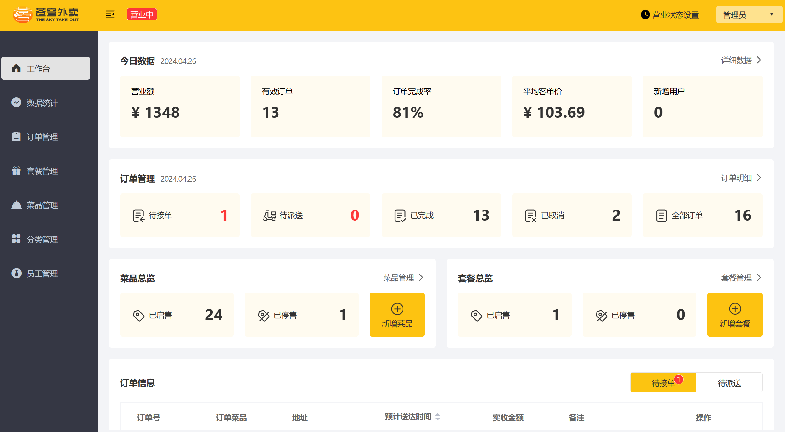
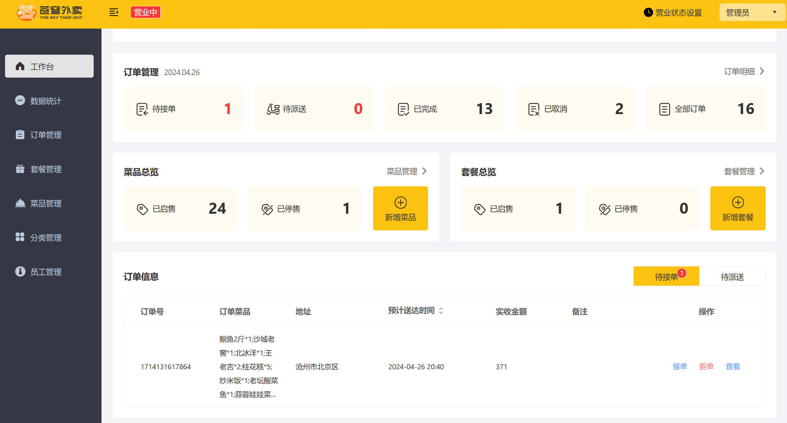
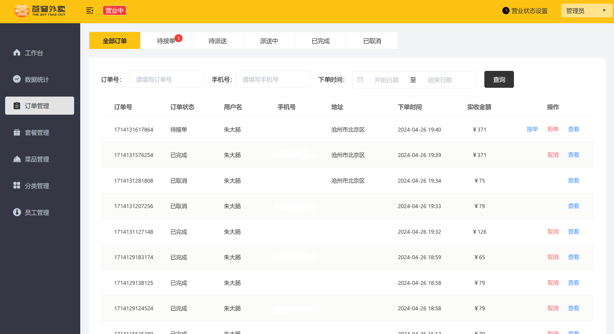
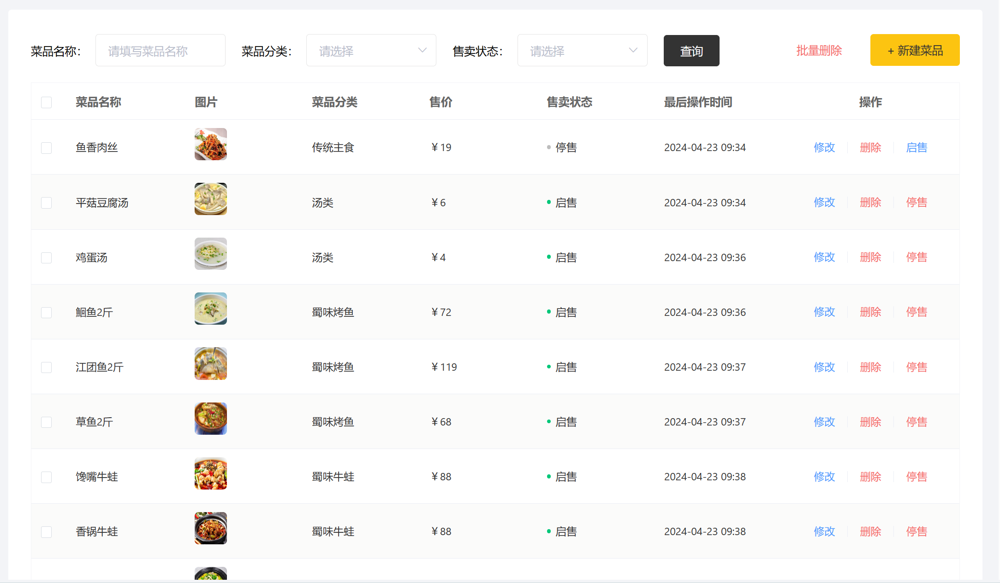

# 苍穹外卖 Sky-Take-Out

## 技术栈

SpringBoot+Mysql+Vue3+WebSocket+Redis+ElementUI

## 环境搭建

> 📖 **完整配置与启动步骤见 [环境配置与启动指南.md](./环境配置与启动指南.md)**（含常见问题排查）

- **前端**
  - Web文件夹下运行nginx.exe文件
- 小程序
  - 微信开发者工具打开 WeiXinApp 文件夹
- 后端
  - 更改sky-server里面的application-dev.yml文件内容
- 数据库
  - 运行sky_take_out.sql

## 项目截图

- 

- 
- 
- 
- 

## 社区团购（本课题核心功能）

小程序**首页右下角**有 **🛒 社区团购** 悬浮入口，进入后可使用：

- 拼团商品列表（含拼团价、成团人数、库存、规格、产地）
- 我要开团 / 去参团（含「还差几人成团」与倒计时）
- 我的拼团（按状态筛选）
- 履约方式：社区自提点自提 或 送货到家

管理端 `http://localhost/` 还可维护**自提点**，并手动触发拼团成团校验 / 关闭超时拼团。

> 本地测试说明：微信开发者工具「游客模式」下 `wx.login` 只返回 mock code，
> 后端已提供 `sky.wechat.mock-login` 开关用于本地登录（见《环境配置与启动指南.md》）。
>
> 注意：游客模式下只会产生**一个**用户，因此「开团」可测，「参团」需要第二个账号，
> 详见《环境配置与启动指南.md》第十节。

## AI 助手（硅基流动 SiliconFlow）

> 说明：该功能的**界面入口已移除**（不属于本课题范围），
> 页面文件 `pages/aiChat/*` 仍保留在项目中，如需启用可自行加回入口。

原本在小程序购物车弹层中有 **AI 助手** 入口，提供类 ChatGPT 的多轮对话能力。

### 使用步骤

1. 在 `pages/index/index.wxml` 中加回指向 `toAIChat` 的入口按钮
2. 首次进入会要求填 API Key → 在 https://cloud.siliconflow.cn/account/ak 创建并复制（格式 `sk-...`）
3. 在 AI 助手页右上角「⚙」设置页填入 Key，选择模型，点击「保存」
4. 返回聊天页即可发送消息

### 支持的模型

- Qwen2.5-7B / 14B / 32B / 72B
- DeepSeek-V2.5 / V3
- GLM-4-9B
- Llama-3.1-8B
- 完整列表：https://docs.siliconflow.cn/cn/api-reference/chat-completions/chat-completions

### 数据存储

所有对话历史存到小程序 localStorage（最多 10MB）。清除小程序数据或卸载会丢失。

### ⚠️ 安全提示

API Key 以明文形式存到小程序端，**任何用户都能在开发者工具里反编译 `vendor.js` 拿到 Key**。本实现**仅供本地学习/演示**。生产环境必须改为后端代理（Key 存服务端）。

建议：
- 在 SiliconFlow 控制台给 Key 设置**月度额度上限**（如 ¥10/月）
- 定期轮换 Key
- 监控账单，发现异常立刻禁用